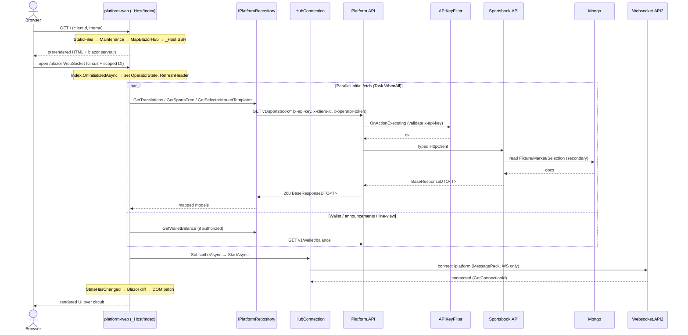
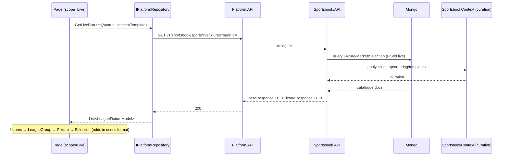
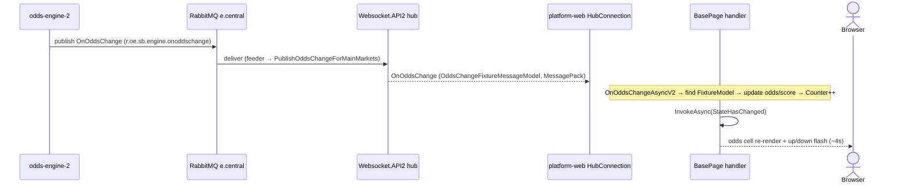
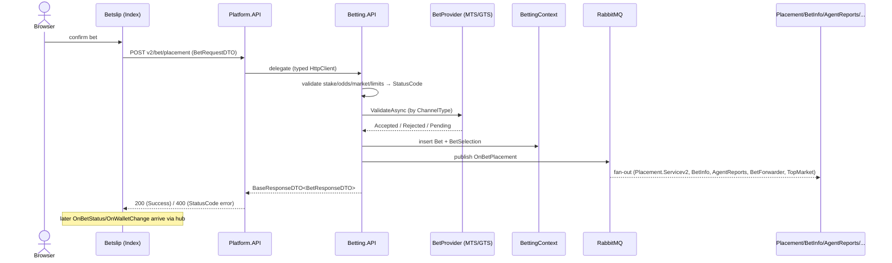
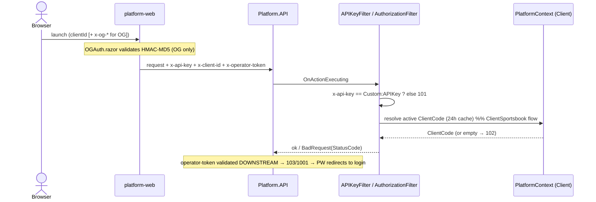
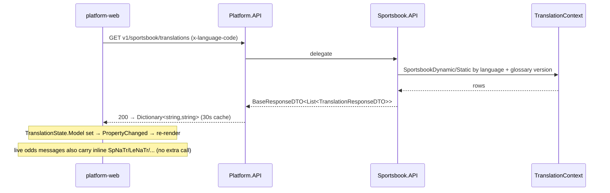

# Sequence Diagrams (End-to-End)

> Phase 4. Mermaid sequence diagrams for the marquee flows, spanning **browser → platform-web →
> platform-final → odds-engine-2**. Provenance tags: **[PW]** platform-web, **[PF]** platform-final,
> **[OE]** odds-engine-2. Narratives: [RequestLifecycle.md](RequestLifecycle.md).

Participants used across diagrams:
`Browser`, `PW` (platform-web Blazor circuit), `PWRepo` (IPlatformRepository), `PWHub` (HubConnection),
`Gateway` (platform-final `Platform.API`), `Filter` (APIKeyFilter), `SB` (Sportsbook.API),
`Bet` (Betting.API), `Mongo`, `SQL`, `MQ` (RabbitMQ e.central), `WS` (Websocket.API2 hub),
`OE` (odds-engine-2), `Settle` (Settlement.Service), `CashOut` (CashOut/CashOutStake services),
`Wallet` (Wallet.API).

---

## 1. Initial application load


## 2. Fixture list load + market render


## 3. Live odds update (push; reverse direction)


## 4. Bet placement (write path + async fan-out)


## 5. Cashout (quote → confirm → settle)
```mermaid
sequenceDiagram
    participant OE as odds-engine-2
    participant CS as CashOutStake.Servicev2
    participant WS as Websocket.API2
    participant PW as MyBetsCashoutButton
    participant Gateway as Platform.API
    participant CashOut as CashOut.Service
    participant SQL as BettingContext

    OE-->>CS: OnOddsChange
    CS->>CS: recompute live cashout value
    CS->>WS: publish OnCashOutChange
    WS-->>PW: OnCashOutChange (new offer)
    PW->>Gateway: POST v1/bet/cashout (BetCashoutRequestDTO)
    Gateway->>CashOut: OnBetFullCashOut / OnBetPartialCashOut
    CashOut->>SQL: write PartialCashoutAudit; update Bet
    CashOut-->>Gateway: result (or 142 value changed → reconfirm)
    Gateway-->>PW: BaseResponseDTO<BetCashoutModel>
```

## 6. Settlement (async, server-side)
```mermaid
sequenceDiagram
    participant OE as odds-engine-2
    participant MQ as RabbitMQ
    participant Settle as Settlement.Service
    participant SQL as BettingContext
    participant Wallet as Wallet.API
    participant Reports as AgentReports.Service
    participant WS as Websocket.API2
    participant PW as platform-web

    OE->>MQ: OnBetSettlement
    MQ->>Settle: deliver (trace context in headers)
    Settle->>SQL: grade BetSelection → Bet status; ParlayBonusAudit; BetAudit
    Settle->>Wallet: credit winnings (if Won)
    Settle->>Reports: winloss
    Settle->>WS: OnBetStatus (r.bet.betstatus.s88)
    WS-->>PW: OnBetStatus / OnWalletChange
    PW-->>PW: update MyBets + wallet display
```

## 7. Authentication (API-key + OG)


## 8. Translation load + language switch


> Rendering: see [RenderingPipeline.md](RenderingPipeline.md). State propagation:
> [StateFlow.md](StateFlow.md). Per-component data: [ComponentDataFlow.md](ComponentDataFlow.md).
> If your Markdown viewer doesn't render Mermaid, the fenced ```mermaid blocks are plain text.
